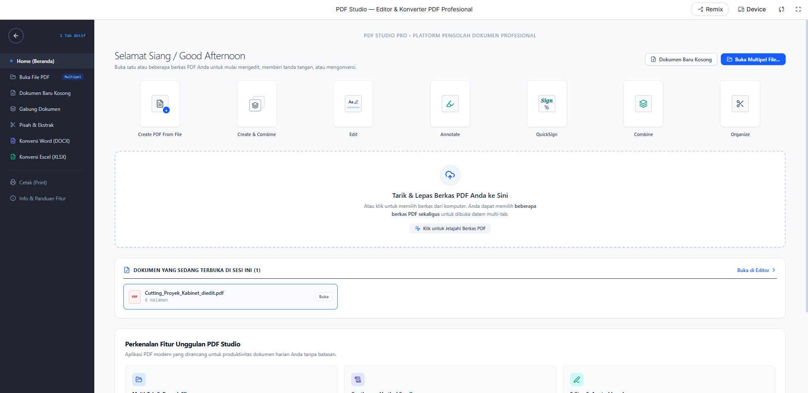

📄 PDF Studio
Professional PDF Document Editor & Converter

<b>All-in-One PDF Management Platform</b>
 
Aplikasi modern untuk mengelola, mengedit, menggabungkan, dan mengonversi dokumen PDF dalam satu platform.

📖 About PDF Studio

PDF Studio adalah aplikasi pengolah dokumen PDF profesional yang dirancang untuk mempermudah berbagai aktivitas pengelolaan dokumen digital.

Aplikasi ini menyediakan berbagai fitur dalam satu tempat, mulai dari membuka dokumen, mengedit PDF, memberikan anotasi, menambahkan tanda tangan digital, menggabungkan beberapa file, memisahkan halaman, hingga mengonversi dokumen PDF ke format Microsoft Word dan Excel.

Dengan desain antarmuka yang modern, minimalis, dan intuitif, PDF Studio bertujuan memberikan pengalaman pengolahan dokumen yang praktis, efisien, dan nyaman digunakan.

📸 Application Preview

<i>PDF Studio — Main Dashboard</i>

✨ Main Features
📁 Document Management
Membuka satu atau beberapa file PDF sekaligus.
Mendukung sistem multi-tab.
Membuat dokumen PDF baru.
Upload dokumen melalui drag and drop.
Mengelola dokumen yang sedang dibuka.
📝 PDF Editing & Annotation
Mengedit dokumen PDF.
Memberikan anotasi pada dokumen.
Menambahkan tanda dan catatan.
Menambahkan tanda tangan digital melalui QuickSign.
🔧 PDF Tools
Create PDF From File — Membuat PDF dari file.
Create & Combine — Membuat dan menggabungkan dokumen.
Combine PDF — Menggabungkan beberapa file PDF.
Organize PDF — Mengatur halaman dokumen.
Split & Extract — Memisahkan dan mengekstrak halaman PDF.
🔄 Document Converter
Konversi PDF ke Microsoft Word (DOCX).
Konversi PDF ke Microsoft Excel (XLSX).
🖨️ Additional Features
Mencetak dokumen PDF.
Dashboard pengelolaan dokumen.
Navigasi fitur yang mudah digunakan.
Antarmuka modern dan responsif.
🧩 Application Menu
Menu	Deskripsi
Home (Beranda)	Menampilkan dashboard utama
Buka File PDF	Membuka dokumen PDF
Dokumen Baru Kosong	Membuat dokumen PDF baru
Gabung Dokumen	Menggabungkan beberapa PDF
Pisah & Ekstrak	Memisahkan atau mengekstrak halaman
Konversi Word (DOCX)	Mengonversi PDF ke Word
Konversi Excel (XLSX)	Mengonversi PDF ke Excel
Cetak (Print)	Mencetak dokumen
Info & Panduan Fitur	Informasi penggunaan aplikasi
🚀 How to Use
Jalankan aplikasi PDF Studio.
Buka halaman dashboard.
Pilih fitur yang ingin digunakan.
Upload dokumen PDF melalui tombol Buka File PDF atau area drag and drop.
Lakukan pengolahan dokumen sesuai kebutuhan.
Simpan atau unduh hasil dokumen jika fitur tersebut tersedia.
🎨 UI & Design

PDF Studio menggunakan pendekatan desain modern dengan fokus pada kemudahan penggunaan.

Karakteristik desain aplikasi:

Clean and Minimalist Interface.
Modern Dashboard Layout.
Intuitive Sidebar Navigation.
Drag and Drop File Upload.
Multi-Tab Document Management.
Organized Feature Cards.
Blue and White Color Scheme.
User-Friendly Experience.
🛠️ Technology Stack

Informasi framework, bahasa pemrograman, library, dan tools yang digunakan dapat ditambahkan sesuai implementasi proyek.

📂 Project Structure
text
PDF-Studio/ 
│ 
├── README.md 
│ 
├── screenshots/ 
│   └── dashboard.png 
│ 
└── (source code aplikasi) 

📌 Development Status

PDF Studio dikembangkan sebagai platform pengolahan dokumen PDF yang mengintegrasikan berbagai kebutuhan pengelolaan file ke dalam satu aplikasi.

Pengembangan selanjutnya dapat mencakup:

Penyempurnaan fitur PDF Editor.
Peningkatan performa pengolahan dokumen.
Penambahan fitur konversi dokumen.
Pengembangan antarmuka pengguna.
Optimalisasi pengalaman penggunaan.
🤝 Contributing

Kontribusi sangat terbuka untuk membantu mengembangkan PDF Studio.

Fork repository ini.
Buat branch baru.
Lakukan perubahan atau pengembangan.
Commit perubahan.
Ajukan Pull Request.
📄 License

Informasi lisensi mengikuti ketentuan lisensi yang ditetapkan pada repository ini.

<b>📄 PDF Studio</b>
 
Professional PDF Document Processing Platform
 
<i>Simplify Your Document Workflow.</i>
  
Made with ❤️

